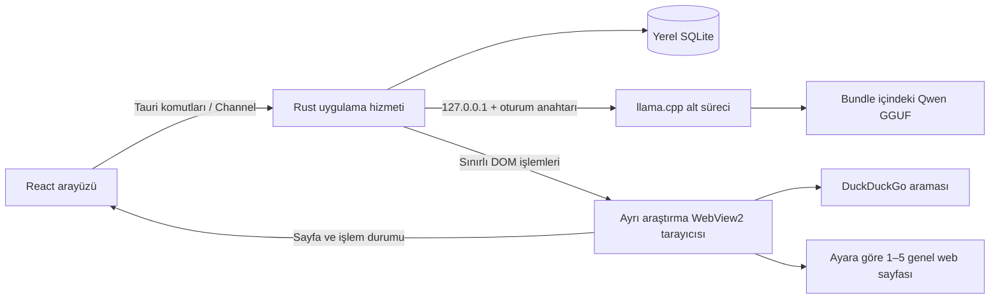

# Aevra mimarisi

## Depo sınırları

| Yol | Sorumluluk |
| --- | --- |
| `src/` | Türkçe arayüz, durum yönetimi, kaynak kartları, akış, tercihler ve temalar |
| `src-tauri/` | Pencere, dar komut arayüzü, uygulama dizinleri ve yaşam döngüsü |
| `crates/aevra-core/src/model.rs` | Dosya doğrulama, motor yönetimi, yerel HTTP ve SSE |
| `crates/aevra-core/src/db.rs` | SQLite şeması ve kalıcı tam konuşma işlemleri |
| `crates/aevra-core/src/research.rs` | Arama, güvenli DNS/HTTPS, boyut sınırlaması, kaynak çıkarımı |
| `crates/aevra-core/src/browser.rs` | Tarayıcı sayfa/eylem tipleri, yerel şemalı planlama ve karar doğrulama |
| `src-tauri/src/browser.rs`, `browser_dom.js` | Görünür WebView2 tarayıcısı, sabit DOM işlemleri, otomatik araştırma döngüsü |
| `crates/aevra-core/src/prompts.rs` | Sohbet/çeviri/araştırma/matematik/kodlama istemleri ve istek doğrulama |
| `scripts/` | Geliştirme, sürüme sabitlenmiş dosyalar, lisanslar ve paketleme |
| `distribution/` | Dağıtım varlık tanımı ve Inno Setup betiği |

## İstek yaşam döngüsü

1. Arayüz seçilen konuşmanın kimliği, metin ve hedef dille istek gönderir. Mod ve tercihler veritabanından okunur.
2. Tek üretim kilidi aynı anda yalnızca bir model isteğine izin verir. İptal istekleri ayrı kanaldan alınır.
3. Motor çalışmıyorsa model/motor dosyalarının SHA-256 değerleri kontrol edilir. Model yalnızca paket dizininden açılır.
4. Motor sabit `127.0.0.1` üzerinde rastgele boş portta, her süreç için yeni bir anahtarla başlar. Kullanıcı haricî bir sunucu URL'si veremez. Windows Job Object alt süreci ana uygulamanın ömrüne bağlar.
5. Araştırmada yerel model, önceki konuşma ve kayıtlı kaynaklarla yeni arama gerekip gerekmediğini planlar. Sorgu yalnız güncel soru ve genel kaynak başlıklarındaki sözcükleri kullanabilir; ham geçmiş ağ katmanına verilmez. Kapalı web ayarı planı aramasız yapar. Yeni ve eski kaynaklar URL ile tekilleştirilip yeniden numaralanır; final isteminde eski kaynak numaraları yerine yeni kaynak kartları esas alınır.
6. SSE yanıtları UTF-8 sınırlarını koruyan ayrıştırıcıyla Tauri Channel üzerinden arayüze aktarılır.
7. Kullanıcı mesajı üretimden önce kaydedilir. Tam, durdurulmuş veya hata almış yanıt içeriği ve kaynakları durumuyla birlikte saklanır. İptalde HTTP akışı kesilir, model hazır kalır.

## Model kararları

Masaüstü araştırması artık [görünür tarayıcı](RESEARCH_BROWSER.md) üzerinden yapılır. `research.rs` içindeki bağımsız HTTP okuyucu önceki çekirdek/smoke denemeleri için korunur; masaüstü sayfalarını okumak için ikinci bir gizli HTTP oturumu kullanılmaz. Ana React WebView'ı ve uzak araştırma WebView'ı ayrıdır; bütün uygulama komutları `main` etiketiyle sınırlandırılır. Boyutlar React panelinden dar Tauri komutuyla gelir. Sabit JavaScript değerlendirmesinin sonucu native callback ile Rust'a döner; uzak sayfalara IPC izni verilmez. Son kaynaklar mevcut sohbet kaydı/istem akışına girer. Ayrıntılı ağ ve form sınırları ilgili belgede belirtilmiştir.

Qwen3.5-9B Q4_K_M ve aynı revision'a ait f16 görsel projector, `distribution/assets.json` içindeki sabit GGUF revision'ından gelir. `--mmproj` ile görsel okuma etkin; CPU'da `--no-mmproj-offload` uygulanır. Görsel başına en fazla 1536 token ayarlanır. Ses/video bu kapsamda yoktur.

Dağıtım llama.cpp b9222'nin ayrı CPU ve Vulkan motorlarını içerir. CPU seçimi `--device none --n-gpu-layers 0`; GPU seçimi algılanan `VulkanN` cihazı ve `--n-gpu-layers auto --fit on --fit-target 1536 --fit-ctx 16384` ile çalışır. Algılamada NVIDIA, sonra AMD/Radeon, ardından diğer Vulkan cihazları tercih edilir. Sistem Vulkan yükleyicisi/sürücüsü gereklidir. Otomatik seçim, GPU algılama/yükleme hatasında CPU'ya döner ve nedeni arayüze iletir; açık GPU seçimi sessizce CPU'ya geçmez. Tercih değişiminde üretim kilidi alınır, motor yeniden hazırlanır. Başarısız değişimde eski ayar ve motor geri yüklenmeye çalışılır. Rastgele motor yolu/argümanları WebView'dan alınmaz.

Bağlam 16.384 token; üretim parçası bütçesi varsayılan 1024, ayarlardan 256–8192 token'dır. `length` bitişinde en fazla 16 parça otomatik devam eder; sınırdaki çıktı `limited` kaydedilir. Yerel tokenizer ile bağlam kontrol edilir; toplam istek süresi yerine boş okuma zaman aşımı uygulanır. Düşünme modu chat-template parametresiyle kapalıdır. Sohbet, araştırma, matematik ve kodlama geçmişinden son tam/kısmi çiftler karakter bütçesine göre seçilir; bu yaklaşık sınır bir tokenizer garantisi değildir. Aşırı uzun/token yoğun girdi sunucuda hata verirse kullanıcıya metni kısaltma bildirimi gösterilir. Çeviri belge parçalarıyla ayrı görevdir; araştırma son konuşma çiftlerini ve kaynaklarını kullanır. Matematik ve kodlama ayrı ağırlıklar değil, aynı modele verilen görev istemleridir. Formüller yerel KaTeX ile `trust:false` kullanılarak gösterilir. Kod yalnızca metin olarak sunulur; yürütülmez. Model yanıtlarının doğruluğu garanti edilmez.

## Dosya ekleri

WebView, `select_attachments` dar komutunu çağırır; yerel dosya seçimi Rust/Tauri iletişim kutusunda yapılır. UI keyfî yol göndermez. Okuyucu seçilen dosyayı 20 MB sınırıyla alır; dosyalar uygulama belleğinde UUID ile bekler. Üretim isteği yalnızca ek kimliklerini taşır. Ek metin/görselleri kullanıcı mesajıyla üretimden önce kaydedilir; geçici bellek temizlenir. Ek kaldırma/yeni sohbet kullanılmayan ekleri temizler.

PNG/JPEG/WebP, UTF-8/UTF-16 metin/kod, DOCX ana metni ve standart OMML denklemleri, Word 97–2003 .doc ana metni, PDF ve ZIP desteklenir. PDFium 8152 paket DLL'i hash denetiminden sonra bir kez yüklenip yeniden kullanılır. En fazla 100 sayfalı PDF'lerden metin çıkarılır; metni çok az olan tüm kabul edilmiş sayfalar görsele çevrilir. Çeviride tümü sırayla, diğer alanlarda ilk 4 görsel işlenir. Metinli sayfada denklem işareti, matematik simgeleri veya gömülü görsel algılanırsa sayfa ayrıca görüntüye çevrilir. Çeviri aynı sayfanın metin ve görüntüsünü tek görevde birleştirir; metni iki kez çevirmeyi önler. Görseller 1536×1536'e sığdırılarak JPEG'e çevrilir; EXIF/özgün dosyalar tutulmaz.

ZIP ve DOCX diske çıkarılmaz; 64 kayıt, 64 MB toplam açılmış boyut ve 200:1 oran üst sınırları uygulanır. Yol kaçışı, mutlak/Windows sürücü yolları, sembolik bağlantılar ve şifreli üyeler reddedilir. ZIP içinde desteklenmeyen türler ve başka ZIP'ler atlanıp kullanıcıya belirtilir; DOCX'te yalnızca `word/document.xml` okunur. XML DTD/dış varlıklar reddedilir; gömülü nesne, ilişki ve kod yürütülmez.

Çıkarılmış metin ek başına 1.000.000 karakterle sınırlıdır ve etiketli 1.600 karakterlik bölümlere ayrılır. Soru kelimeleriyle eşleşen bölümler öne alınır; modele toplam en fazla 8.000 karakter, görsel varsa 4.000 karakter aktarılır. Çeviri bu seçiciyi kullanmaz: tüm metin/görsel parçaları sayfa sırasıyla ayrı isteklerde çevrilir, ilerleme bildirilir. Diğer alanlarda bu yerel ve basit bir bölüm seçicidir; tüm dosyayı gördüğü veya kapsamlı anlamsal arama yaptığı iddia edilmez. Yeni ek yoksa en son ekler yerel konuşmanın devamında kullanılır. Araştırmada dosya ekleri reddedilir; arama katmanına yalnızca sınırlandırılmış plan sorgusu gider.

## SQLite v5

`conversations(id, title, mode, updated_at, archived)`, `messages(seq, id, conversation_id, role, content, created_at, sources, status, attachments)` ve `preferences(id, value)` tabloları vardır. Modlar `chat`, `translate`, `research`, `math`, `code` olarak sınırlıdır. Mesajlar monoton `seq` ile sıralanır. Kaynaklar, ekler ve tercihler yapılandırılmış JSON'dur. Ekler çıkarılmış metni ve normalleştirilmiş JPEG verisini içerir; özgün dosya yolu tutulmaz. Foreign key ve silme kaskadı, WAL, secure_delete ve busy timeout etkindir. `user_version=5`; v1/v2/v3/v4 geçmişi silinmeden göç ettirilir, daha yeni şema açılması reddedilir. v3 geçişi konuşma tablosunun mod kısıtını işlem içinde genişletir; ardından yabancı anahtar bütünlüğü denetlenir. v4, varsayılan boş ek sütununu ekler. Biçim-2 yedekleri ekleri içerir; biçim-1 içe alımı korunur. Eski tercihlerde bulunmayan donanım seçimi Otomatik olur.

## Dağıtım

Tauri'nin web arayüzü uygulama ikilisine gömülür. Model ve motor ayrı kaynak dosyaları olarak uygulamanın yanında kurulur. Büyük model için Inno Setup kurulum EXE'si ve `.bin` dilimleri tek ZIP64 dağıtım paketinde taşınır. Microsoft C++ runtime uygulama yanında, Microsoft WebView2 standalone installer kurulum verisi içinde bulunur. Model eksikse paketleme kesilir; ilk açılışta internetten tamamlamaya geçilmez.

## PDF çıktısı

`export_message_pdf` konuşma/yanıt kimliği ile sınırlandırılmış MathAsset listesini kabul eder. Yanıt SQLite'tan okunur, yerel dosya penceresinde hedef seçilir; PDFium ve paket Noto Sans ile sayfalı metin PDF'si üretilir. Geçici dosya aynı klasörde oluşturulup atomik olarak hedefe taşınır. Yazı tipi manifestte hash denetimlidir. Kısmi yanıtlar işaretlenir. MathJax 3.2.2 yerel SVG yolları üretir; Rust yalnız kayıtlı yanıt içindeki formüllerle eşleşen SVGleri resvg ile işler. Dış href, olay, DTD, CSS url ve izin dışı SVG öğeleri reddedilir; toplam boyut/adet sınırlıdır. Satır içi formüller taban çizgisine, blok formüller ortaya hizalanır; yüksek çözünürlüklü görsel ve görünmez LaTeX metni PDF’ye eklenir. Metin/kod/başlık/kaynak ve sayfalama korunur; özgün belge tasarımı yeniden oluşturulmaz.

## Kişisel hafıza

memory.rs kaynak temizleme, literal dayanak doğrulama, sabit alanlar, sınırlı üslup geri bildirimi ve ilgili kayıt seçimini içerir. memory/store.rs SQLite kayıt/kanıt/kuyruk/blok/geri alma işlemleridir. Tauri memory_service.rs bunları dar komutlarla sunar; yerel modeli ortak üretim kilidiyle sıraya koyar. Ön plan istekleri çıkarımı iptal edip kilidi öncelikle alır. Yeni iş yalnız tamamlanan yeni bir kullanıcı turundan eklenir; kuyruk yeniden başlatmada sürer, eski sohbetlerden tarama yapılmaz.

v5 göçü konuşmaya memory_disabled ekler; memories, memory_evidence, memory_blocks, memory_changes, memory_jobs, memory_meta tablolarını oluşturur. Anahtarlar 13 sabit alandır; SQL girdileri parametrelidir. Kaynak alıntısı yeni kullanıcı mesajının alt dizisi, değer alıntının alt dizisi olmalıdır. Asistan yanıtları, dosyalar, web alıntıları çıkarım girdisi değildir. Üslup gözlemleri normalize edilir; üç farklı konuşma olmadan pending kayıt isteme girmez. Aynı alandaki açık güncel bilgi öncekinin yerini alır. Proje kayıtları 90, pending tercihler 30 gün geçerlidir.

Çıkarım tek seferlik, 768 token ve 45 saniye sınırındadır; eksik/bozuk çıktı kaydedilmez ve görünür bildirim verilir. llama.cpp b9222 için response_format.json_schema.schema kullanılır; README örneğindeki doğrudan schema alanı bu tip için yeterli değildir. Sürümün [gerçek ayrıştırıcısı](https://github.com/ggml-org/llama.cpp/blob/b9222/tools/server/server-common.cpp) ile doğrulandı; protokol testi iç içe şema alanını sınar. JSON biçimi bilgilerin anlamsal doğruluğunu garanti etmez.

İlgili en fazla altı kayıt final yerel system istemine veri olarak eklenir; güncel mesaj önceliklidir. Araştırma planlayıcısı ve HTTP sorgusu bu kayıtları almaz. Çeviri çıktısı kişisel hafızayla değiştirilmez. Global kapatma veya konuşmaya özgü memory_disabled hem okuma hem yazmayı engeller. Her düzenleme/silme/izin/kapatma revizyonu artırır; eski kuyruk/çalışan analiz yeni kayıt yazamaz. Unutma yalnız anahtar bloklarını tutar; silinen değer/alıntı/kanıt/geri alma günlüğü temizlenir. Geri alma on dakika ve güncel sürümle aynı snapshot için geçerlidir; daha yeni düzenlemeyi ezmez. Alanı engeller, eski sohbetlerden yeniden türetilmez. JSON sohbet yedeği hafızayı dışa/içe aktarmaz; hafızasız sohbet işareti taşınır. Windows hesabı dışındaki uygulama içi profil yönetimi kapsamda değildir.
